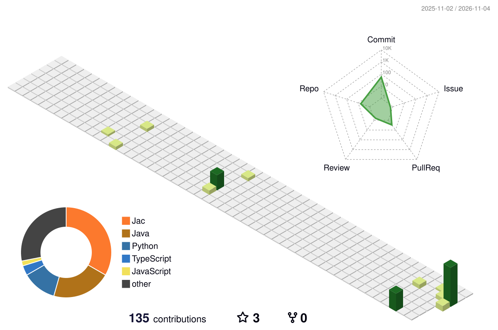

## 👨‍💻 About me

- 🎓 BSc (Hons) AI & Data Science at **Robert Gordon University**, studying at **IIT Colombo**
- 🛠️ I turn messy data into decisions people can act on, with a focus on **data engineering**
- 🌱 Currently building **JobPulse** and leading **LeafToPort**, my team's data science group project
- 🤝 Batch representative and active IEEE volunteer; I organise events and bring teams together
- 🎯 Goal: grow into an AI engineer, combining finance domain knowledge with AI

## 🧰 Tech stack

  

## 🚀 Featured projects

| Project | What it does | Built with |
|---|---|---|
| **JobPulse** | Labour market intelligence for Sri Lanka's tech sector: collects job postings, extracts skills with NLP and serves a trends dashboard | TypeScript, Next.js, Fastify, FastAPI, PostgreSQL + pgvector, BullMQ |
| **LeafToPort** | Tea export decision support: auction price forecasting plus an international-event "what-if" price impact analyzer (team project, Team Leader) | Python, time-series forecasting |
| **VOLTRIX** | End-to-end ML pipeline predicting Bitcoin price movements from Binance data; I built the technical-indicator feature layer (team project) | Python, `ta`, Binance API |
| **AI Incident Intelligence Platform** | Watches running apps, detects anomalies, forecasts load and explains incidents with an AI agent grounded in live telemetry | In progress |

## 🏙️ Contribution graph

  

