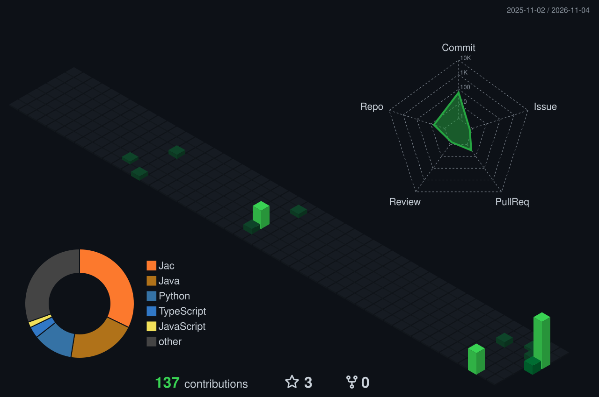

## About

- BSc (Hons) in Artificial Intelligence and Data Science, Robert Gordon University (delivered at IIT Colombo)
- Focused on data engineering: building the pipelines and platforms that turn raw data into decisions
- Currently building JobPulse, a labour market intelligence platform, and leading LeafToPort, a team data science project
- Active IEEE volunteer, organising events and supporting team collaboration
- Goal: to grow into an AI engineer, combining finance domain knowledge with applied AI

## Technical skills

  

## Featured projects

| Project | What it does | Built with |
|---|---|---|
| **JobPulse** | Labour market intelligence for Sri Lanka's tech sector: collects job postings, extracts skills with NLP and serves a trends dashboard | TypeScript, Next.js, Fastify, FastAPI, PostgreSQL + pgvector, BullMQ |
| **LeafToPort** | Tea export decision support: auction price forecasting plus an international-event "what-if" price impact analyzer (team project, Team Leader) | Python, time-series forecasting |
| **VOLTRIX** | End-to-end ML pipeline predicting Bitcoin price movements from Binance data; I built the technical-indicator feature layer (team project) | Python, `ta`, Binance API |
| **AI Incident Intelligence Platform** | Watches running apps, detects anomalies, forecasts load and explains incidents with an AI agent grounded in live telemetry | In progress |

## Contribution activity

  

