---

## 👋 About

- Preparing for the AWS Cloud Practitioner exam and the Coursera Machine Learning Specialization
- Active IEEE member and volunteer
- Interested in data pipelines and CI/CD for machine learning
- Building practical data and machine learning projects
- Looking for a data engineering or machine learning internship
- Long-term goal: AI engineer, with a finance angle

---

## 🧰 Tech Stack

| Area | Tools |
|---|---|
| **Languages** |   |
| **Web and APIs** |   |
| **Databases** |     |
| **DevOps and Tools** |  |
| **ML and Data Science** |         |
| **R and Simulation** |      |
| **Data Engineering** |        |
| **Learning next** |    |

---

## 🚀 Featured Projects

| Project | What it does | Built with |
|---|---|---|
| **JobPulse** | Labour market intelligence for Sri Lanka's tech sector: collects public job postings, extracts the skills they ask for and shows demand trends on a dashboard | TypeScript, Next.js, Fastify, FastAPI, PostgreSQL + pgvector, BullMQ |
| **LeafToPort** | Tea export decision support: auction price forecasting plus an international-event "what-if" price impact analyzer (team project, Team Leader) | Python, time-series forecasting |
| **VOLTRIX** | End-to-end ML pipeline predicting Bitcoin price movements from Binance data; I built the technical-indicator feature layer (team project) | Python, ta, Binance API |
| **[Incident platform](https://github.com/Afshad-M/incidentPlatform)** | Open-source, self-hosted tool that watches running apps, detects anomalies and explains incidents with an AI agent grounded in live telemetry (in progress, built with a teammate) | Redpanda, dbt, Airflow, Docker |

---

## 🏙️ Contribution Activity

  

